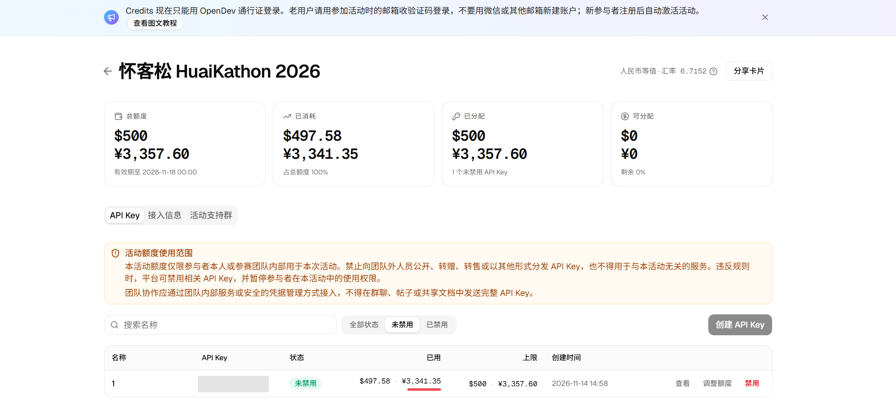
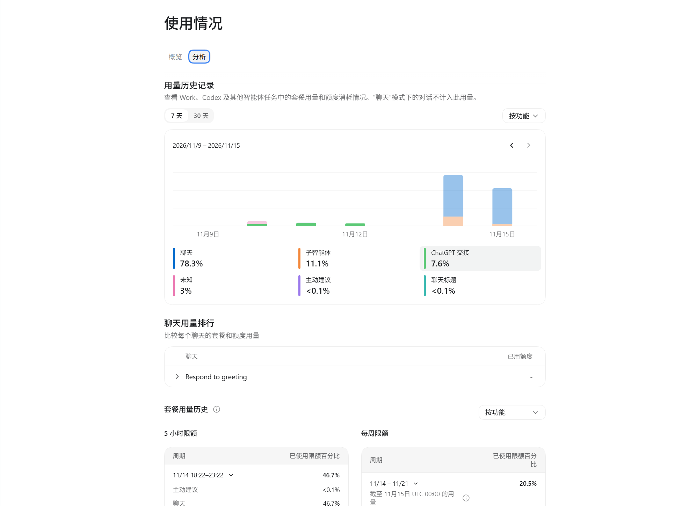

# 单位经济账单：Token 消耗与 ROI 测算

编制日期：2026-11-16。线上站点：https://39.105.92.190:8443

项目处于早期，还没有真实成交，拿不出"实际 token 花费换来多少实际利润"的证据。所以本账单只做两件事：**用截图证明已经消耗了多少 token，再用实测的单项目消耗加明确标注的假设，测算 ROI**。测算里的转化率是假设，不是事实。

消耗分两类，分开记，不要相加：**网站运行时的消耗**（第 1～3 节，用户每用一次产生的 token）和**开发阶段的消耗**（第 4 节，做出这个网站本身用掉的 AI 额度）。

## 提交摘要

当前可提供三张消耗截图：线上累计 11,958 token、开发 API 已用 $497.58，以及订阅使用比例。后两项没有提供实际 token 数，不能换算成精确 token 总量。

按 80㎡ 演示项目、3% 服务费和 5% 假设结算转化率，每个进入系统的项目约消耗 2.64 万 token，期望服务费约 179.23 元，扣除文字 token 成本后约 179.02 元。开发额度与一个月订阅按面值合计约 3,475.65 元，按此假设需要约 20 个项目覆盖。**以上为自行测算，实际商业利润尚无成交证据，图像及其他经营成本待补。**

## 1. 消耗证明：线上老板控制台截图

截图取自线上站点 `/boss` 的"成本概览"页，2026-11-16 09:17 用老板账号截取，未做任何修改。

| 项目 | 数值 |
|---|---|
| 任务总数 | 106（完成 100，失败 0） |
| 任务 Token 合计 | 11,958 |
| 图像调用 | 82 |
| 户型识别 | 27 个任务，合计 11,958 token |
| 二维设计、报价工期、质检 | 0 token（这三个环节是规则计算，不调用大模型） |

11,958 token 全部来自两次户型识别：5,907 和 6,051。按 DeepSeek 官方定价页（2026-11-16 查看）的 `deepseek-flash` 高峰输出价 8 元/百万 token 全部计价，上限约 **0.10 元**。

这个面板只统计任务内的 token。报价说明草稿、聊天回复草稿和改图不在其中，页面底部也写明了这一点。

## 2. 一个项目要消耗多少 token（实测）

测试环境：本机隔离服务器和临时数据库，真实 DeepSeek 密钥，80㎡ 演示项目，不碰线上数据。每个数字都是接口返回的 `usage.total_tokens`。

| 环节 | 单次 token | 一个项目的次数（假设） | 合计 token |
|---|---:|---:|---:|
| 户型识别 | 约 5,979（线上两次的平均） | 1 | 5,979 |
| 匹配排序 | 2,067（实测 1 次） | 3（每家投标触发一次） | 6,201 |
| 报价说明草稿 | 约 1,375（1,322 / 1,497 / 1,307） | 3 | 4,125 |
| 聊天回复草稿 | 约 1,010（1,004 / 1,016） | 10 | 10,100 |
| 二维设计、报价工期、质检 | 0 | - | 0 |
| **合计** | | | **约 26,400** |

次数是我们设的典型值：3 家装修队投标，1 个项目沟通 10 轮。

按上限单价 8 元/百万 token 计，**每个项目的 token 费用约 0.21 元**。

## 3. ROI 测算

### 收入口径

- 平台只在合同阶段**成功结算**时收服务费，默认演示费率 3%，正式费率待验证（见 [V2使用与部署说明](V2使用与部署说明.md)）。
- 用 80㎡ 演示项目的平台参考报价 119,488 元作合同额，则一个项目签约并全部结算时，服务费收入为 **3,584.6 元**。
- 会员费（39 元/月）是另一项独立业务，不计入。

### 假设

只有"多少个项目能走到签约并结算"需要假设。线上目前结算笔数是 0，没有真实数据，所以给三档：

| 转化率（假设） | 每个项目期望收入 | 每个项目 token 费用 | 每个项目净贡献 | Token 投入产出比 | 每百万 token 带来的收入 |
|---:|---:|---:|---:|---:|---:|
| 1% | 35.8 元 | 0.21 元 | 35.6 元 | 约 169 倍 | 约 1,358 元 |
| 5% | 179.2 元 | 0.21 元 | 179.0 元 | 约 848 倍 | 约 6,788 元 |
| 10% | 358.5 元 | 0.21 元 | 358.3 元 | 约 1,696 倍 | 约 13,575 元 |

表内计算保留未四舍五入的数值：按约 26,400 token × 8 元/百万 token，单项目成本为 0.2112 元；合同服务费为 119,488 × 3% = 3,584.64 元。金额展示再四舍五入。这里的“净贡献”仅指扣除文字 token 成本后的测算余额，不是已实现商业利润。

计算：期望收入 = 转化率 × 3,584.6；净贡献 = 期望收入 - token 费用；投入产出比 = 净贡献 ÷ token 费用。

**盈亏平衡**：转化率只要超过 0.006%（约每 17,000 个项目签成 1 个），token 费用就能被服务费收入覆盖。

**敏感性**：如果开启思考模式使 token 增到 10 倍，每个项目 token 费用约 2.11 元，转化率 1% 时每个项目净贡献仍约 33.7 元。

## 4. 开发阶段投入与回收测算

前三节是网站运行时的消耗。这一节是做出这个网站本身用掉的 AI 额度。

### 4.1 消耗证明（两张截图）

**图 A：怀客松活动的 API 额度页**（Next 平台，截图时间 2026-11-16 09:27）。API Key 片段和账号头像已遮盖。

| 项目 | 数值 |
|---|---|
| 活动总额度 | $500（¥3,357.60） |
| 已消耗 | $497.58（¥3,341.35），约占总额度 99.5% |
| 可分配余额 | $0 |
| 汇率 | 页面按 6.7152 折算人民币 |
| 密钥创建时间 / 额度有效期 | 2026-11-14 14:58 / 至 2026-11-18 00:00 |

人民币数字核对过：497.58 × 6.7152 = 3,341.35。

两点需要说明：
- 这是活动提供的额度，不是我们付的现金。下面按面值折算，当作开发投入的价值，不代表实际现金支出。
- 页面没有标明额度花在哪些模型或工具上。我把网站运行用的几把密钥（DeepSeek、Agnes、MiMo 等）和这把密钥的片段逐一比对，没有一把相符，但密钥不同只能证明调用凭据不同，不能单独证明账单归属完全没有重叠；两类消耗因此分别展示，不合并声称总 token 消耗。

**图 B：ChatGPT Plus 使用情况页**（截图时间 2026-11-16 09:02）。

截图里能读到的数字：

- 统计区间 2026/11/9 至 11/15。各功能占用量的比例：聊天 78.3%，子智能体 11.1%，ChatGPT 交接 7.6%，未知 3%，主动建议和聊天标题各低于 0.1%。
- 5 小时限额：11/14 18:22 至 23:22 用了 46.7%。
- 每周限额：11/14 至 11/21 这一周，截至 11/15 UTC 00:00 用了 20.5%。

截图里没有订阅月费。订阅费由你提供：**$20/月**，按 11 月一个月计入，折合 ¥134.30（20 × 6.7152，沿用图 A 页面的汇率）。这个数字没有截图佐证。

### 4.2 回收测算

开发阶段投入合计：

| 项目 | 美元 | 人民币 |
|---|---:|---:|
| 活动 API 额度（图 A，按面值折算） | $497.58 | ¥3,341.35 |
| ChatGPT Plus 订阅（一个月） | $20.00 | ¥134.30 |
| **合计** | **$517.58** | **¥3,475.65** |

用第 3 节的收入口径来算：

- 一个 80㎡ 项目合同额 119,488 元，按演示费率 3%，服务费收入 3,584.6 元，扣掉该项目的 token 费用 0.21 元，净贡献约 3,584.4 元。
- 3,475.65 ÷ 3,584.4 ≈ **0.97**。也就是说，**成功结算一个同等规模的合同，服务费就能覆盖这笔开发投入的面值**。

换成转化率视角，需要多少个项目进入系统才能回收（开发投入 ÷ 每项目期望净贡献，项目数向上取整；这是期望值测算，不保证实际在该项目数内回本）：

| 转化率（假设） | 每个项目净贡献 | 回收开发投入所需项目数 |
|---:|---:|---:|
| 1% | 35.6 元 | 约 98 个 |
| 5% | 179.0 元 | 约 20 个 |
| 10% | 358.3 元 | 约 10 个 |

这里的限制和第 5 节相同：只比较 token 与服务费，没有算人工、服务器、获客；3% 是演示费率；转化率是假设。活动额度是赠送的，实际现金支出只有订阅费一项，所以按面值折算会高估真实资金压力。

## 5. 这份账单不能说明什么

1. **这是 token 的投入产出比，不是公司利润率。** 人工审核、获客、服务器、邮件、支付通道等成本都没算。token 费用在总成本里占比很小，所以这个倍数看起来很大。
2. **转化率是假设。** 线上没有任何一笔合同结算，不能说明已经赚到钱。
3. **费率 3% 是演示费率**，真实费率、退费规则和费用范围还要验证。
4. **效果图没计入。** 图像由 Agnes 生成，按次计费，没有查到公开单价。线上有 82 张图，等取得单价后补一行。
5. **线上会员付款记录有 3 条**（2 条已确认，1 条待支付），没有核对是否为真实收入，因此不计入。
6. 参考报价 119,488 元来自演示项目的合成数据，不是真实合同。

## 6. 后续怎么补证据

- 向 Next 平台确认图 A 的 $497.58 具体花在了哪些模型上；如果 ChatGPT Plus 不止订阅一个月，按实际月数补上订阅费。
- 取得 Agnes 单价，把图像成本加进每个项目的费用。
- 采集 5～10 个真实户型的实际 token 和耗时，替换第 2 节的假设次数。
- 出现第一笔真实结算后，用实际服务费替换假设转化率。
