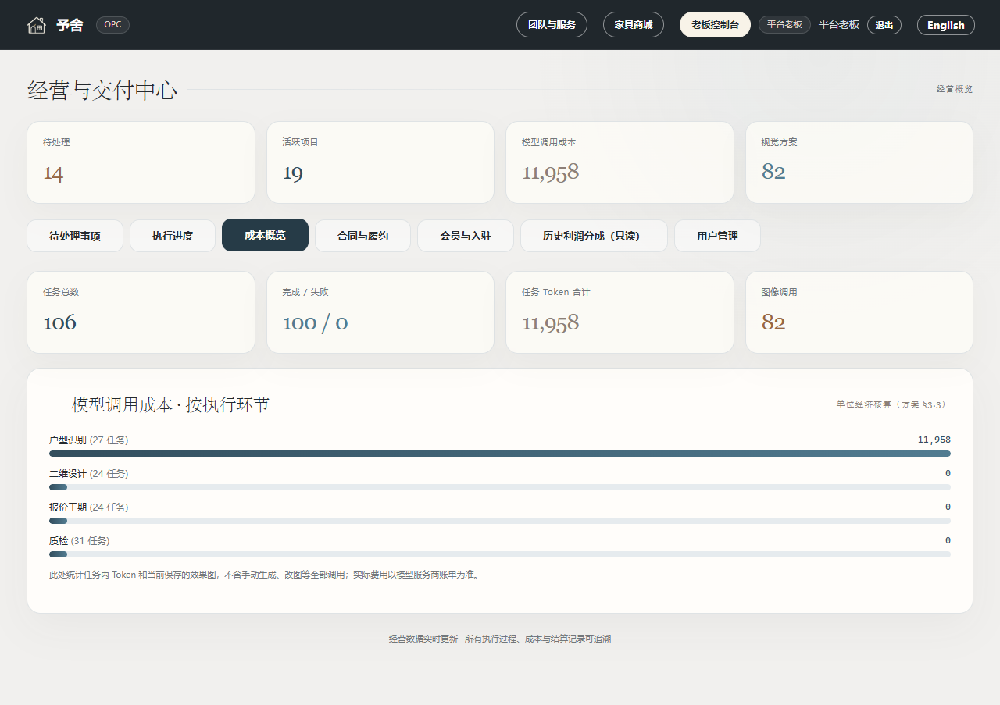

# 单位经济账单：Token 消耗与 ROI 测算

编制日期：2026-11-16。线上站点：https://39.105.92.190:8443

项目处于早期，还没有真实成交，拿不出"实际 token 花费换来多少实际利润"的证据。所以本账单只做两件事：**用截图证明已经消耗了多少 token，再用实测的单项目消耗加明确标注的假设，测算 ROI**。测算里的转化率是假设，不是事实。

## 1. 消耗证明：线上老板控制台截图

截图取自线上站点 `/boss` 的"成本概览"页，2026-11-16 09:17 用老板账号截取，未做任何修改。

| 项目 | 数值 |
|---|---|
| 任务总数 | 106（完成 100，失败 0） |
| 任务 Token 合计 | 11,958 |
| 图像调用 | 82 |
| 户型识别 | 27 个任务，合计 11,958 token |
| 二维设计、报价工期、质检 | 0 token（这三个环节是规则计算，不调用大模型） |

11,958 token 全部来自两次户型识别：5,907 和 6,051。按 DeepSeek 官方定价页（2026-11-16 查看）的 `deepseek-flash` 高峰输出价 8 元/百万 token 全部计价，上限约 **0.10 元**。

这个面板只统计任务内的 token。报价说明草稿、聊天回复草稿和改图不在其中，页面底部也写明了这一点。

## 2. 一个项目要消耗多少 token（实测）

测试环境：本机隔离服务器和临时数据库，真实 DeepSeek 密钥，80㎡ 演示项目，不碰线上数据。每个数字都是接口返回的 `usage.total_tokens`。

| 环节 | 单次 token | 一个项目的次数（假设） | 合计 token |
|---|---:|---:|---:|
| 户型识别 | 约 5,979（线上两次的平均） | 1 | 5,979 |
| 匹配排序 | 2,067（实测 1 次） | 3（每家投标触发一次） | 6,201 |
| 报价说明草稿 | 约 1,375（1,322 / 1,497 / 1,307） | 3 | 4,125 |
| 聊天回复草稿 | 约 1,010（1,004 / 1,016） | 10 | 10,100 |
| 二维设计、报价工期、质检 | 0 | - | 0 |
| **合计** | | | **约 26,400** |

次数是我们设的典型值：3 家装修队投标，1 个项目沟通 10 轮。

按上限单价 8 元/百万 token 计，**每个项目的 token 费用约 0.21 元**。

## 3. ROI 测算

### 收入口径

- 平台只在合同阶段**成功结算**时收服务费，默认演示费率 3%，正式费率待验证（见 [V2使用与部署说明](V2使用与部署说明.md)）。
- 用 80㎡ 演示项目的平台参考报价 119,488 元作合同额，则一个项目签约并全部结算时，服务费收入为 **3,584.6 元**。
- 会员费（39 元/月）是另一项独立业务，不计入。

### 假设

只有"多少个项目能走到签约并结算"需要假设。线上目前结算笔数是 0，没有真实数据，所以给三档：

| 转化率（假设） | 每个项目期望收入 | 每个项目 token 费用 | 每个项目净贡献 | Token 投入产出比 | 每百万 token 带来的收入 |
|---:|---:|---:|---:|---:|---:|
| 1% | 35.8 元 | 0.21 元 | 35.6 元 | 约 169 倍 | 约 1,358 元 |
| 5% | 179.2 元 | 0.21 元 | 179.0 元 | 约 847 倍 | 约 6,788 元 |
| 10% | 358.5 元 | 0.21 元 | 358.3 元 | 约 1,696 倍 | 约 13,575 元 |

计算：期望收入 = 转化率 × 3,584.6；净贡献 = 期望收入 - token 费用；投入产出比 = 净贡献 ÷ token 费用。

**盈亏平衡**：转化率只要超过 0.006%（约每 17,000 个项目签成 1 个），token 费用就能被服务费收入覆盖。

**敏感性**：如果开启思考模式使 token 增到 10 倍，每个项目 token 费用约 2.11 元，转化率 1% 时每个项目净贡献仍约 33.7 元。

## 4. 这份账单不能说明什么

1. **这是 token 的投入产出比，不是公司利润率。** 人工审核、获客、服务器、邮件、支付通道等成本都没算。token 费用在总成本里占比很小，所以这个倍数看起来很大。
2. **转化率是假设。** 线上没有任何一笔合同结算，不能说明已经赚到钱。
3. **费率 3% 是演示费率**，真实费率、退费规则和费用范围还要验证。
4. **效果图没计入。** 图像由 Agnes 生成，按次计费，没有查到公开单价。线上有 82 张图，等取得单价后补一行。
5. **线上会员付款记录有 3 条**（2 条已确认，1 条待支付），没有核对是否为真实收入，因此不计入。
6. 参考报价 119,488 元来自演示项目的合成数据，不是真实合同。

## 5. 后续怎么补证据

- 取得 Agnes 单价，把图像成本加进每个项目的费用。
- 采集 5～10 个真实户型的实际 token 和耗时，替换第 2 节的假设次数。
- 出现第一笔真实结算后，用实际服务费替换假设转化率。
